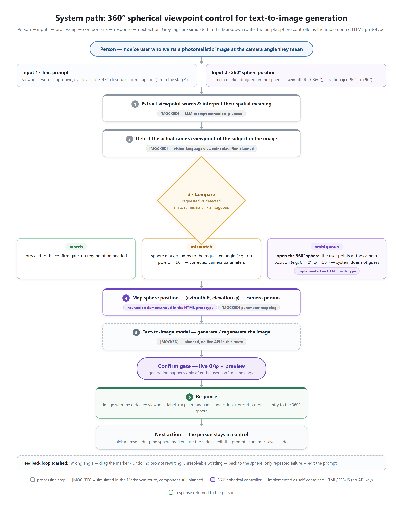

# 01_SPEC.md: use case and system path

Use this file for the use case from your Week 2 storyboard. Keep the notes short enough to use while you work.

**Use case (from the Week 2 storyboard):** helping users of text-to-image generative AI specify and correct a subject's camera viewpoint. The default **Markdown simulation route** is used: mocked components are explicitly tagged `[MOCKED]`. One self-contained piece, the 360° spherical viewpoint controller (`sphere_controller.html`), is implemented as an interactive prototype.

## User goal
As a novice user of text-to-image generative AI, I want to generate a photorealistic image whose camera viewpoint matches what I described, and to adjust the angle with little trial-and-error — including precise angles that fixed preset buttons cannot reach.

## System inputs
- The user's text prompt, including viewpoint words (top-down / bird's-eye, eye-level, side view, 45-degree, close-up) and metaphorical expressions such as "looking down at it from the stage".
- The currently generated image.
- Behaviour signals: repeated prompt rewrites and repeated regenerations.
- A camera position selected on the 360° spherical viewpoint controller: **azimuth θ (0–360°)** and **elevation φ (−90° to +90°)**.

## Processing and technology
1. **Extract** viewpoint words from the prompt and interpret their spatial meaning. — LLM prompt extraction, *planned* `[MOCKED in the Markdown simulation]`.
2. **Detect** the actual camera viewpoint of the subject in the generated image. — vision-language viewpoint classifier, *planned* `[MOCKED]`.
3. **Compare** the requested vs detected viewpoint → `match` / `mismatch` / `ambiguous`.
4. **Map** the camera position on the sphere into (azimuth θ, elevation φ), then into the text-to-image model's camera-control parameters. `[MOCKED]`; the interaction is demonstrated by the implemented HTML prototype `sphere_controller.html`.
5. On `mismatch`, build a regeneration request with corrected camera parameters; on `ambiguous`, open the spherical controller for clarification instead of guessing.

| Processing component | Technology / model | Status |
|---|---|---|
| Viewpoint word extraction | LLM prompt extraction | `[MOCKED]` — planned |
| Viewpoint detection in the image | Vision-language viewpoint classifier | `[MOCKED]` — planned |
| **Sphere position capture → (θ, φ) → camera parameters** | Self-contained HTML/CSS/JS prototype (`sphere_controller.html`) | **Implemented** (UI capture & interaction) / **`[MOCKED]`** (model parameter mapping) |
| Camera-aware image generation | Text-to-image diffusion model | `[MOCKED]` — planned, no API key |

**Technology summary:** the default route is a structured Markdown simulation (no API keys, no Python/Git required). The 360° spherical controller is a self-contained HTML/CSS/JS prototype (implemented, opens offline). The text-to-image model, the prompt extractor and the viewpoint detector are planned components, marked `[MOCKED]`.

## Intended result and next action
- The system returns the image labelled with the detected viewpoint, a plain-language suggestion (e.g. "Detected a low-angle view, which does not match your request — switch to top-down?"), the preset buttons, and an entry point to the 360° sphere.
- For a precise angle, the sphere shows live θ/φ values and a preview; **generation happens only after the user confirms the angle**.
- The person can next: pick a preset, drag the camera marker or fine-tune it with the θ/φ sliders, edit the prompt, confirm/save, or press Undo.

## Fallback strategy
- **No viewpoint word in the prompt:** ask "Which camera angle do you want?" and open the sphere; never guess.
- **Vague or metaphorical wording:** open the 360° sphere, which highlights 2–3 candidate anchor positions near the likely angle and lets the user point at the desired position by dragging the marker or tapping a candidate; the controller is touch-friendly so the same fallback works on mobile. Never map a metaphor to a literal angle.
- **Low viewpoint-detection confidence:** state honestly "I'm not sure about the current angle" and ask the user to confirm on the sphere.
- **Requested angle cannot be rendered:** say so honestly and offer the nearest achievable position on the sphere.

## System path or interaction diagram

The diagram (`system_path.png`, exported from `system_path.html`) shows the person, the two inputs (text prompt and sphere position), the extract → detect → compare → map processing steps, the components with their implemented / simulated status, the confirm gate, the response, and the next action. Components labelled `[MOCKED]` are simulated in the Markdown route; the purple spherical controller is the implemented HTML prototype.

The interactive prototype is `sphere_controller.html` (open in any browser; no API key needed). The Week 2 storyboard this use case is taken from is kept in the `storyboard/` folder (`01_interaction_flow.png`, `02_normal_storyboard.png`, `03_failure_recovery.png`, `04_secondary_user.png`).

## Test A: standard input
Input:
> "Generate a photorealistic portrait of a cat, top-down view."

What the system receives:
- The prompt contains a clear viewpoint word: **top-down**.
- The generated image shows the cat from a **low angle** (detected by the viewpoint classifier `[MOCKED]`).

What it does:
- Comparison result: **mismatch**.
- The sphere camera marker moves to the top pole (elevation φ = 90°), and a regeneration request with top-down camera parameters is built `[MOCKED]`.

Response and next action:
- A new top-down image is returned with the message "Switched to a top-down view" and a Save button.
- The user inspects the result and saves it.

## Test B: problem input
Input:
> "make it look like you're looking down at it from the stage"

What the system receives:
- No standard angle term; the phrase is a metaphor (the audience looking down at the stage) and cannot be mapped to one definite angle.
- Comparison result: **ambiguous**.

What it does:
- The system does **not** generate. It opens the 360° spherical controller and asks the user to point at the desired angle.
- The user drags the camera marker to a high front position — azimuth θ ≈ 0°, elevation φ ≈ 55° (the audience looking down at the stage).
- The system maps that position to camera parameters and builds the regeneration request `[MOCKED]`.

Response and next action:
- "I can't map that phrase to an exact angle. Please point to the position you want on the sphere." Live θ/φ values are shown; the user confirms, then the image is generated at that angle. Undo is available if the angle is wrong.

## Review and revision
**Review questions used, with evidence from the tests:**
- **Q3 — Could the person correct a wrong extraction or decision?** Evidence: in Test B, if the suggested position is wrong, the user drags the camera marker directly on the sphere; no prompt rewriting is needed.
- **Q4 — Did it ask for missing information instead of guessing?** Evidence: Test B does not map the metaphor to a literal top-down view; it opens the sphere and asks the user to point.
- **Q5 — Did it keep the person in control of the next action?** Evidence: generation happens only after the user confirms the angle on the sphere.

**Problem identified:**
Metaphorical viewpoint phrases are misread as literal camera angles (e.g. "looking down from the stage" read as a literal top-down view), producing wrong images and forcing repeated prompt rewrites.

**One interaction change:**
Replace reliance on fixed preset buttons with the 360° spherical controller as the main control: the camera marker is draggable to any angle, while the preset buttons remain as shortcuts, θ/φ are shown in plain language (elevation / azimuth), and an explicit **Undo / "Not happy"** button is added.

**One technology / system change:**
Add a sphere-position → (azimuth θ, elevation φ) → model camera-parameter mapping step, and change the fallback so that ambiguous viewpoint phrases open the sphere for user selection instead of triggering an immediate generation.

**Test B re-run after the revision:**
- Before: the system guessed "top-down" from the metaphor and generated a wrong image; the user could only rewrite the prompt.
- After: the system does not guess; it opens the sphere, the user points to the high front position (θ ≈ 0°, φ ≈ 55°) and confirms, and the image is generated at that angle. If it is still wrong, the user drags the marker once more or presses Undo.

**Why this helps (2–3 sentences):**
The revision replaces a language-guessing step with a direct geometric choice: instead of asking the model to interpret a metaphor, the user points the camera on the sphere, which removes the ambiguity. Generation only happens after the user confirms the angle, so control stays with the person. The sphere also doubles as a correction channel — a wrong angle can be moved in one drag, with no prompt rewriting.
